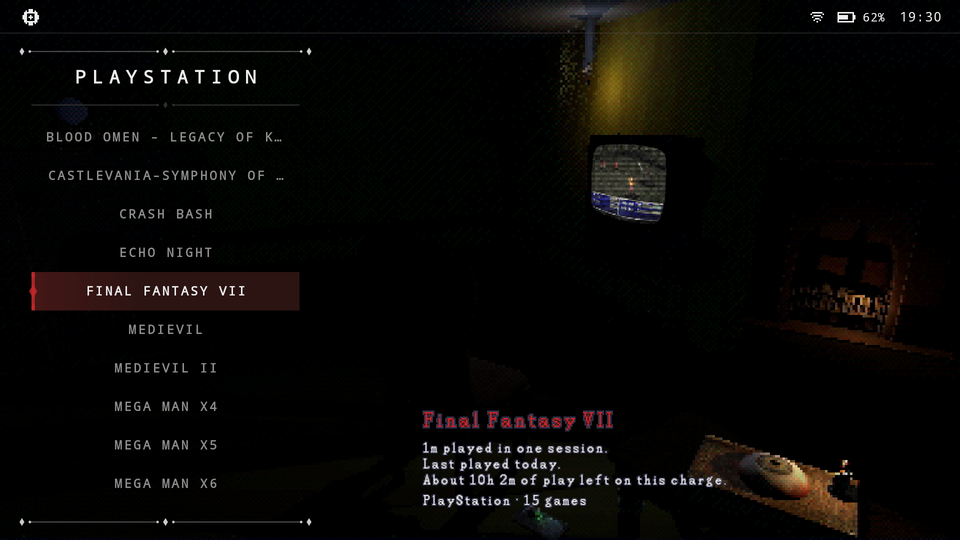
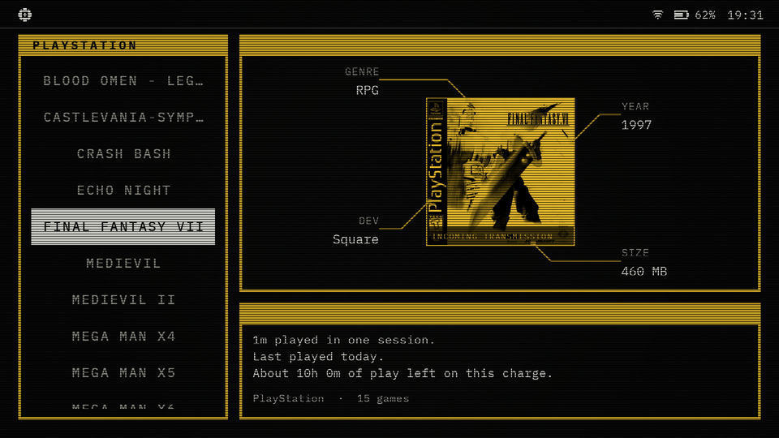
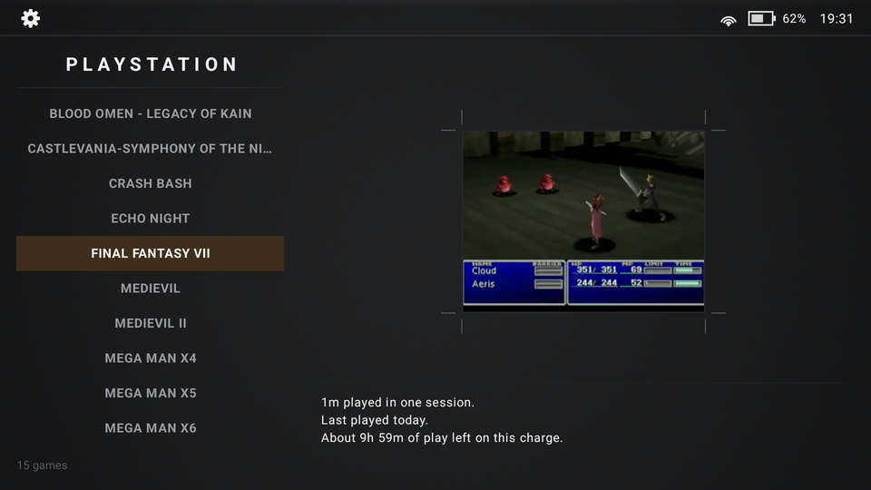

# Ludolog assets

The downloadable extras for [Ludolog](https://github.com/monkikolab/ludolog-front-end), a front-end
for retro handhelds: the game catalog and the themes. **You don't need to download anything from
here.** Ludolog fetches them for you, from its welcome screen and from Settings.

## Themes

| Parlour | Mainframe | Gallery |
|:---:|:---:|:---:|
|  |  |  |

Each theme brings its own backgrounds, spinning consoles, sounds and fonts. Gallery also comes
inside the app.

## Game catalog

Names, genres, release dates, developers and short synopses for games on many consoles, so Ludolog
can show them and find each game's box art. Ludolog only downloads the consoles you have.

## AI assistance disclosure

AI assistance was used while building this project. I reviewed the code throughout development and
understand how the app works and what it does.

## Licences

- **Catalog:** CC BY-SA 4.0, compiled from libretro-database, Wikidata, Wikipedia and GameTDB.
- **Themes:** [CC BY-NC-SA 4.0](https://creativecommons.org/licenses/by-nc-sa/4.0/): free to share and
  adapt, with credit, not for commercial use, and under the same licence. A few third-party parts
  (3D models, two Parlour sounds, the Parlour dialog font, the Mainframe fonts) keep their own
  terms.

Credits and sources are in [NOTICE](NOTICE.md), and in the `NOTICE.md` that comes with each release.
